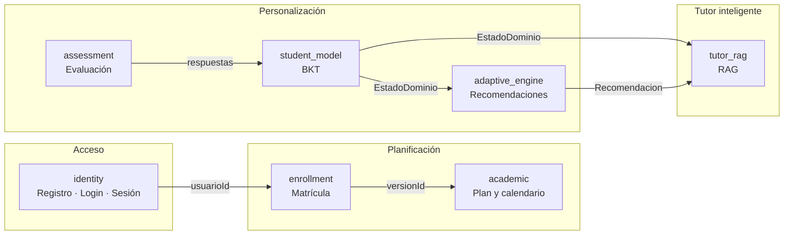
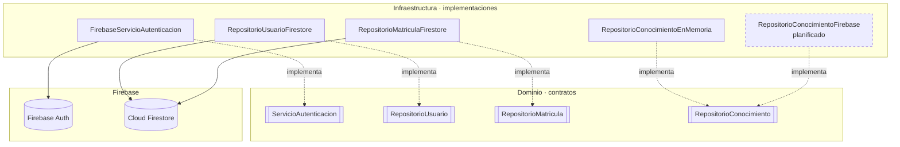
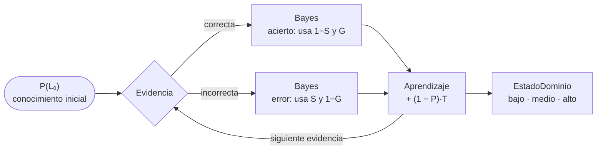
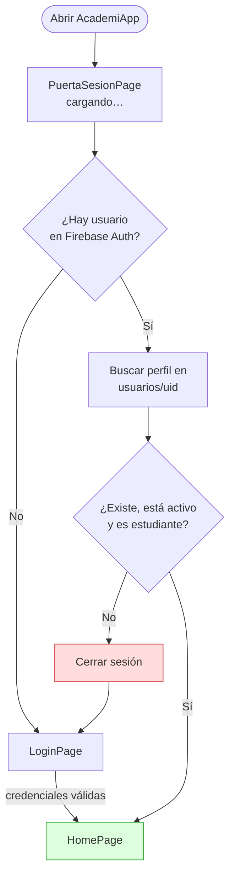
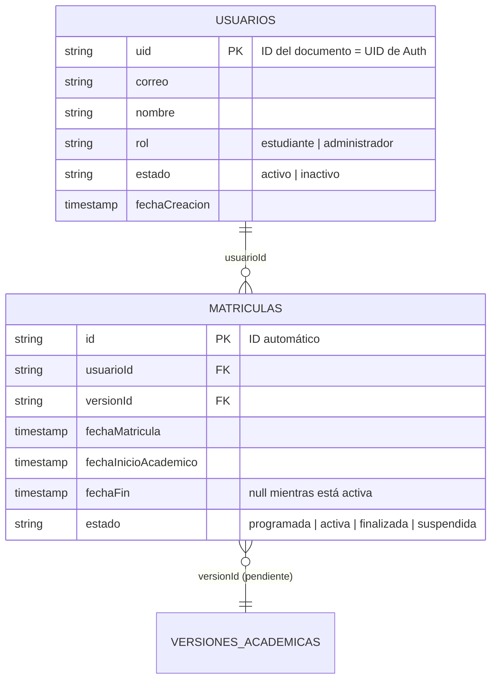
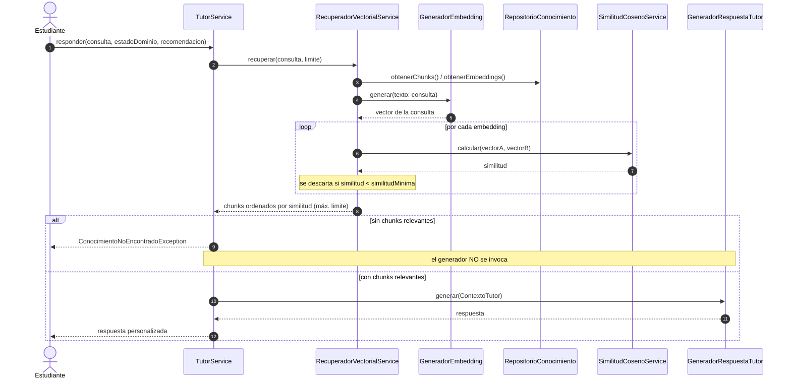

# AcademiApp v2


Aplicación en **Flutter** para el acompañamiento académico personalizado de estudiantes. Integra **autenticación y datos en Firebase** (Auth + Cloud Firestore), un **modelo del estudiante** basado en *Bayesian Knowledge Tracing* (BKT), un **motor adaptativo** que genera recomendaciones según el nivel de dominio y un **tutor con RAG** (*Retrieval-Augmented Generation*) que responde usando solo conocimiento validado.

> Proyecto desarrollado como parte de una tesis de pregrado — Universidad Nacional de San Cristóbal de Huamanga (UNSCH).

---

## Tabla de contenidos

- [Arquitectura](#arquitectura)
- [Módulos](#módulos)
- [Flujo de sesión](#flujo-de-sesión)
- [Datos en Firestore](#datos-en-firestore)
- [Flujo del tutor RAG](#flujo-del-tutor-rag)
- [Decisiones de diseño](#decisiones-de-diseño)
- [Estructura del proyecto](#estructura-del-proyecto)
- [Requisitos](#requisitos)
- [Instalación](#instalación)
- [Configuración de Firebase](#configuración-de-firebase)
- [Pruebas y calidad](#pruebas-y-calidad)
- [Convención de commits](#convención-de-commits)
- [Estado del proyecto](#estado-del-proyecto)

---

## Arquitectura

El proyecto sigue **Clean Architecture** organizada por *features*. Cada módulo separa:

| Capa | Responsabilidad |
|---|---|
| `domain/entities` | Modelos del negocio, sin dependencias externas. |
| `domain/repositories` | Contratos (clases abstractas) que el dominio necesita. |
| `domain/services` | Reglas de negocio puras y testeables. |
| `infrastructure` | Implementaciones concretas de los contratos (memoria, Firebase…). |
| `presentation` | Páginas y widgets de Flutter. |

**Regla principal:** el dominio no conoce la infraestructura. Las dependencias siempre apuntan hacia el dominio.

### Diagrama de módulos



### Dominio e infraestructura



Las implementaciones de Firebase se crean **en un único lugar**, `main.dart`, y se inyectan hacia abajo:

```text
main.dart  →  AcademiApp  →  PuertaSesionPage  →  servicios del dominio
   └─ FirebaseServicioAutenticacion()
   └─ RepositorioUsuarioFirestore()
```

Ninguna página ni servicio del dominio llama a `FirebaseAuth.instance` o `FirebaseFirestore.instance` directamente.

---

## Módulos

### `identity` — Identidad y sesión
Entidades: `UsuarioAutenticado` (lo que devuelve Auth), `UsuarioAcademiApp` (perfil en Firestore) y `EstadoSesionEstudiante` (`cargando`, `noAutenticado`, `autenticado`).

| Enum | Valores |
|---|---|
| `RolUsuario` | `estudiante`, `administrador` |
| `EstadoUsuario` | `activo`, `inactivo` |

Servicios:

- `RegistrarEstudianteService`: crea la cuenta en Auth y el perfil en Firestore con rol `estudiante`. **Si falla al guardar el perfil, elimina la cuenta de Auth** para no dejar usuarios a medias.
- `IniciarSesionEstudianteService`: autentica y valida que el perfil exista, esté `activo` y tenga rol `estudiante`; si no, cierra la sesión.
- `RecuperarSesionEstudianteService`: al abrir la app, recupera el usuario actual con las mismas validaciones.
- `ResolverEstadoInicialSesionService`: traduce lo anterior a un `EstadoSesionEstudiante`.

Presentación:

- `PuertaSesionPage`: muestra un indicador de carga y decide entre `LoginPage` y `HomePage`.
- `LoginPage`: valida el formulario antes de llamar al servicio (correo vacío, correo sin `@`, contraseña vacía) y muestra un mensaje genérico si las credenciales fallan, sin exponer errores técnicos.

### `academic` — Planificación académica
Entidades: `Area`, `Curso`, `Tema`, `Contenido`, `Recurso`, `PlanAcademico`, `VersionAcademica`, `DiaAcademico`, `ActividadProgramada`.

- `SecuenciaAcademicaService`: ordena los temas de los cursos en una secuencia de estudio.
- `CalendarioAcademicoService`: genera los días académicos del plan.
- `ActividadesDelDiaService`: obtiene las actividades programadas para un día.

### `enrollment` — Matrícula
Entidad `Matricula`: vincula a un estudiante (`usuarioId`) con una versión académica (`versionId`). Estados: `programada`, `activa`, `finalizada`, `suspendida`.

- `RepositorioMatricula` (contrato) y `RepositorioMatriculaFirestore` (implementación): obtienen la matrícula del estudiante desde Firestore.
- `CalcularInicioAcademicoService`: calcula la fecha de inicio académico a partir de la matrícula y su configuración.

### `assessment` — Evaluación
Entidades: `Evaluacion`, `Pregunta`, `Opcion`, `Respuesta`, `IntentoEvaluacion`, `ResultadoEvaluacion`.

- `CalcularResultadoEvaluacionService`: calcula el resultado de un intento a partir de las respuestas.

### `student_model` — Modelo del estudiante (BKT)
Entidades: `Habilidad`, `PreguntaHabilidad`, `Evidencia`, `ParametrosBkt`, `EstadoDominio`.

- `GenerarEvidenciasService`: convierte respuestas en evidencias por habilidad.
- `ModeloBktService`: actualiza la probabilidad de dominio con BKT.
- `CalcularEstadoDominioService`: recorre las evidencias en orden cronológico y devuelve el `EstadoDominio`.

**Parámetros BKT** (todos entre 0 y 1): conocimiento inicial *P(L₀)*, aprendizaje *P(T)*, adivinanza *P(G)* y desliz *P(S)*.

Actualización tras cada evidencia:

$$
P(L \mid \text{correcta}) = \frac{P(L)\,(1-S)}{P(L)\,(1-S) + (1-P(L))\,G}
\qquad
P(L \mid \text{incorrecta}) = \frac{P(L)\,S}{P(L)\,S + (1-P(L))\,(1-G)}
$$

$$
P(L_{t+1}) = P(L \mid \text{obs}) + \bigl(1 - P(L \mid \text{obs})\bigr)\,T
$$



**Clasificación del nivel de dominio:**

| Valor | Nivel |
|---|---|
| `< 0.50` | `bajo` |
| `0.50 – 0.79` | `medio` |
| `≥ 0.80` | `alto` |

### `adaptive_engine` — Motor adaptativo
- `AdaptiveEngineService.generarRecomendacion()`: transforma un `EstadoDominio` en una `Recomendacion`.
- `AdaptiveEngineService.construirMiRuta()`: genera recomendaciones para varias habilidades ordenadas por prioridad.

| Nivel de dominio | Recomendación | Prioridad |
|---|---|---|
| `bajo` | `reforzar` | 3 |
| `medio` | `practicar` | 2 |
| `alto` | `profundizar` | 1 |

### `tutor_rag` — Tutor con RAG
Entidades: `DocumentoConocimiento`, `ChunkConocimiento`, `EmbeddingChunk`, `ConsultaTutor`, `ContextoTutor`.

Contratos (`domain/repositories`):

| Contrato | Responsabilidad |
|---|---|
| `RepositorioConocimiento` | Acceso a chunks y embeddings almacenados. |
| `RecuperadorConocimiento` | Recuperar los chunks relevantes para una consulta. |
| `GeneradorEmbedding` | Convertir texto en vector. |
| `GeneradorRespuestaTutor` | Generar la respuesta final a partir del contexto. |

Servicios:

- `RecuperadorPorTextoService`: recuperación por coincidencia de palabras.
- `RecuperadorVectorialService`: recuperación por similitud coseno, con umbral configurable `similitudMinima` (por defecto `0.5`, rango `[-1, 1]`).
- `SimilitudCosenoService`: calcula la similitud coseno entre dos vectores.
- `TutorService`: orquesta la recuperación y la generación. **Si no recupera conocimiento relevante, lanza `ConocimientoNoEncontradoException` y no llama al generador**, para evitar respuestas inventadas.

---

## Flujo de sesión



Siguiente paso en este flujo: tras autenticar, leer la **matrícula activa** del estudiante para obtener su `versionId` y cargar su plan académico.

```text
Estudiante autenticado → RepositorioMatriculaFirestore → matrícula activa → versionId → VersionAcademica
```

---

## Datos en Firestore



**Convenciones**

- Los enums se guardan como texto con su `.name` (`"activo"`, `"estudiante"`, `"activa"`).
- Las fechas se guardan como `timestamp`, nunca como texto.
- El ID del documento en `usuarios` es el mismo UID de Firebase Auth.

**Reglas de seguridad** (`firestore.rules`)

| Colección | Estudiante | Administrador / backend |
|---|---|---|
| `matriculas` | Solo **lee** su propia matrícula | Crea y gestiona matrículas |

El estudiante no puede crearse ni modificarse una matrícula. Mientras no exista el panel administrativo, las matrículas de prueba se crean manualmente desde Firebase Console.

---

## Flujo del tutor RAG

### Vista general

```mermaid
flowchart LR
    subgraph Personalizacion["1 · Personalización"]
        direction TB
        EV[Evidencias] --> BKT[ModeloBktService]
        BKT --> ED[EstadoDominio]
        ED --> AE[AdaptiveEngineService]
        AE --> REC[Recomendacion]
    end

    subgraph Recuperacion["2 · Recuperación"]
        direction TB
        RCON{{RecuperadorConocimiento}}
        RCON --> RT[Por texto]
        RCON --> RV["Vectorial<br/>similitud ≥ similitudMinima"]
        RT --> REPO[(RepositorioConocimiento)]
        RV --> REPO
    end

    subgraph Generacion["3 · Generación"]
        direction TB
        Q{¿Chunks<br/>relevantes?}
        Q -- Sí --> CTX[ContextoTutor] --> GEN[GeneradorRespuestaTutor] --> RESP[Respuesta]
        Q -- No --> EX[ConocimientoNoEncontradoException]
    end

    CT[ConsultaTutor] --> TS[TutorService]
    ED --> TS
    REC --> TS
    TS --> RCON
    REPO --> Q

    style EX fill:#fdd,stroke:#c33
    style RESP fill:#dfd,stroke:#3a3
```



### Secuencia de `TutorService.responder()`



---

## Decisiones de diseño

| Decisión | Motivo |
|---|---|
| **Contratos en el dominio** (`RepositorioConocimiento`, `GeneradorEmbedding`, `GeneradorRespuestaTutor`) | El dominio no depende de Firebase ni de un proveedor de IA concreto; se pueden reemplazar sin tocar las reglas de negocio. |
| **`AlmacenVectorial` → `RepositorioConocimiento`** | El recuperador por texto también lo usa; el nombre debía describir *qué* guarda, no *cómo* se busca. |
| **Umbral `similitudMinima`** | Evita que el recuperador vectorial devuelva siempre "lo menos malo" aunque no tenga relación con la consulta. |
| **El tutor no responde sin conocimiento** | Si la recuperación está vacía se lanza `ConocimientoNoEncontradoException` y no se llama al generador: se priorizan respuestas fundamentadas sobre respuestas inventadas. |
| **El contexto incluye `EstadoDominio` y `Recomendacion`** | La respuesta del tutor se adapta al nivel del estudiante (reforzar, practicar o profundizar). |
| **Firebase solo se instancia en `main.dart`** | `AcademiApp` recibe sus dependencias por constructor; así las pruebas de widgets usan dobles y no necesitan `Firebase.initializeApp()`. |
| **Validar perfil además de Auth** | Tener cuenta en Firebase Auth no basta: el usuario debe tener perfil en `usuarios`, estar `activo` y ser `estudiante`. |
| **Registro con rollback** | Si se crea la cuenta en Auth pero falla el perfil en Firestore, se elimina la cuenta para no dejar usuarios huérfanos. |
| **Matrículas creadas por administración** | Las reglas impiden que un estudiante se matricule a sí mismo; solo puede leer su matrícula. |
| **Mensajes de error genéricos en el login** | No se muestran excepciones técnicas ni se revela si el correo existe. |
| **Dobles de prueba en lugar de servicios reales** | Las pruebas son deterministas, rápidas y no requieren red ni credenciales. |

---

## Estructura del proyecto

```text
lib/
├── main.dart                 # inicializa Firebase e inyecta dependencias
├── firebase_options.dart     # generado por flutterfire configure
├── app/
│   └── app.dart              # AcademiApp → PuertaSesionPage
└── features/
    ├── identity/
    │   ├── domain/{entities,repositories,services}
    │   ├── infrastructure/{repositories,services}
    │   └── presentation/pages  # PuertaSesionPage, LoginPage
    ├── academic/
    │   ├── domain/{entities,services}
    │   └── presentation/pages  # HomePage
    ├── adaptive_engine/domain/{entities,services}
    ├── assessment/domain/{entities,services}
    ├── enrollment/
    │   ├── domain/{entities,repositories,services}
    │   └── infrastructure/repositories
    ├── student_model/domain/{entities,services}
    └── tutor_rag/
        ├── domain/{entities,exceptions,repositories,services}
        └── infrastructure/repositories

test/
├── widget_test.dart
└── features/
    ├── identity/ …
    ├── academic/ …
    ├── adaptive_engine/ …
    ├── assessment/ …
    ├── enrollment/ …
    ├── student_model/ …
    └── tutor_rag/
        ├── domain/{entities,repositories,services}
        ├── infrastructure/repositories
        └── integration/tutor_rag_integration_test.dart
```

---

## Requisitos

- [Flutter SDK](https://docs.flutter.dev/get-started/install) (canal estable) y Dart 3
- Git
- Node.js LTS (para Firebase CLI)
- Firebase CLI y FlutterFire CLI (para la integración con Firebase)

---

## Instalación

```powershell
git clone <url-del-repositorio>
cd academiapp-v2
flutter pub get
flutter run -d edge     # o -d chrome / un dispositivo Android
```

> No hay configuración de Firebase para Windows de escritorio: ejecuta en web o Android.

---

## Configuración de Firebase

Servicios usados: **Firebase Authentication** (correo y contraseña) y **Cloud Firestore**.
Proyecto: `academiapp-v2-7b9ce`.

```powershell
# 1. Herramientas
npm install -g firebase-tools
dart pub global activate flutterfire_cli
firebase login

# 2. Vincular la app Flutter (genera lib/firebase_options.dart)
flutterfire configure

# 3. Vincular la carpeta con el proyecto (genera .firebaserc)
firebase use academiapp-v2-7b9ce

# 4. Publicar las reglas de seguridad
firebase deploy --only firestore:rules
```

**Problemas frecuentes en Windows**

| Síntoma | Solución |
|---|---|
| `flutterfire` no se reconoce | Agregar `C:\Users\<usuario>\AppData\Local\Pub\Cache\bin` al `PATH` y reiniciar VS Code. |
| PowerShell bloquea `firebase` | `Set-ExecutionPolicy -Scope CurrentUser RemoteSigned` |
| `No currently active project` al desplegar | `firebase use academiapp-v2-7b9ce` |
| Web: `Couldn't resolve the package 'flutter_web_plugins'` | Declarar `flutter_web_plugins: sdk: flutter` en `pubspec.yaml`, luego `flutter clean` y `flutter pub get`. |
| `[core/no-app]` en `flutter test` | Un widget creó Firebase en una prueba: inyectar dobles en `AcademiApp` en lugar de instancias reales. |

---

## Pruebas y calidad

Antes de cada commit:

```powershell
dart format lib test
flutter analyze
flutter test
```

Criterio de aceptación: **`flutter analyze` sin problemas y todas las pruebas en verde** (actualmente **72**).

Las pruebas usan **dobles de prueba** (implementaciones falsas de los contratos) para verificar el dominio sin depender de servicios externos:

- Los servicios de `identity` se prueban con autenticación y repositorio de usuarios falsos (perfil inexistente, inactivo, con otro rol, fallo al guardar).
- `widget_test.dart` monta `AcademiApp` con una sesión vacía y comprueba que se muestre el inicio de sesión, sin conectarse a Firebase.
- `tutor_rag_integration_test.dart` valida el flujo completo del tutor con el repositorio en memoria, incluido el caso en que no hay conocimiento relevante.

La comunicación real con Firebase (Auth, `usuarios`, `matriculas`) se verifica manualmente con un estudiante de prueba en `flutter run -d edge`.

---

## Convención de commits

Se usa [Conventional Commits](https://www.conventionalcommits.org/es/):

```text
feat(tutor_rag): agregar similitud minima al recuperador vectorial
test(tutor_rag): verificar que el tutor no responde sin conocimiento relevante
refactor(tutor_rag): renombrar AlmacenVectorial a RepositorioConocimiento
feat(identity): agregar pantalla de inicio de sesion
feat(enrollment): agregar RepositorioMatriculaFirestore
chore(firebase): vincular proyecto y desplegar reglas de Firestore
```

Usa siempre `git commit -m "mensaje"` para evitar que se abra el editor (Vim). Si se abre, sal con `Esc` → `:q!` → `Enter`.

---

## Estado del proyecto

**Dominio**
- [x] Planificación académica, matrícula y evaluación
- [x] Modelo del estudiante con BKT
- [x] Motor adaptativo de recomendaciones
- [x] Tutor RAG: recuperación textual y vectorial con umbral de similitud
- [x] Prueba de integración del tutor RAG

**Firebase e identidad**
- [x] Firebase inicializado (web) e inyección de dependencias desde `main.dart`
- [x] Registro, inicio de sesión y recuperación de sesión del estudiante
- [x] Perfiles en `usuarios` con validación de rol y estado
- [x] `PuertaSesionPage` y `LoginPage` con validación de formulario
- [x] `RepositorioMatriculaFirestore` y reglas de Firestore desplegadas
- [ ] Lectura real de la matrícula activa desde la app
- [ ] Colección `versiones_academicas` vinculada por `versionId`

**Pendiente**
- [ ] Repositorio de conocimiento en Firebase
- [ ] Generador de embeddings real
- [ ] Generador de respuestas con LLM
- [ ] Interfaz del tutor y de "Mi ruta"
- [ ] Panel administrativo (matrículas)

---

## Autor

**Elvis Llampasi** — Universidad Nacional de San Cristóbal de Huamanga
